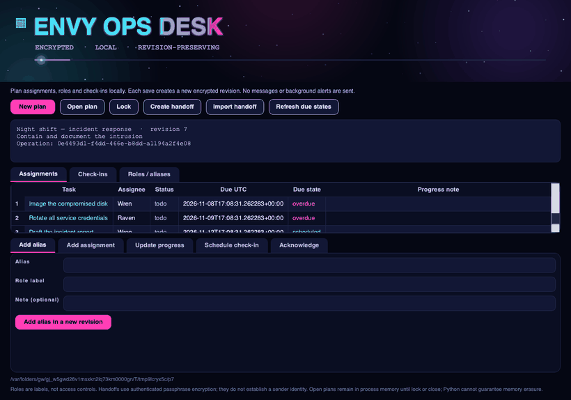
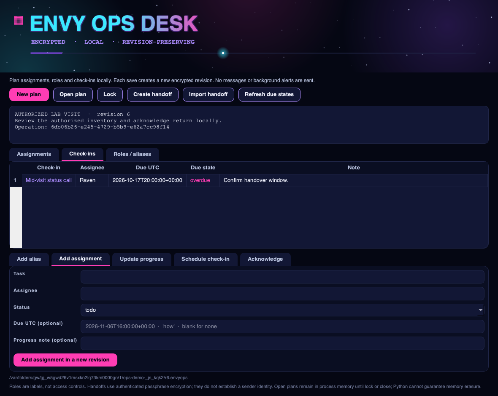

<p align="center">
  
</p>

<p align="center"><b>Plan an operation locally — role aliases, task assignments, progress, scheduled check-ins and acknowledgements — in a real native app window.</b><br />
AES-256-GCM plans, a hash-chained revision journal, computed due states, authenticated handoffs and plaintext export. From ENVY BLACK VEIL, as a standalone app.</p>

<p align="center">
  <a href="https://github.com/xzchick/envy-ops-desk/actions/workflows/tests.yml"></a>
</p>
<p align="center">
  
  
  <br />
  
  
  
</p>

<p align="center">
  <a href="#install"><b>Install</b></a> ·
  <a href="#works-on">Compatibility</a> ·
  <a href="#using-it">Using it</a> ·
  <a href="#honest-by-design">What it isn't</a> ·
  <a href="#build--test">Build</a>
</p>

<p align="center">
  
</p>

<p align="center"><sub>A real native window — not a browser view. The title pulses, the stars twinkle, and a light travels the accent bar.</sub></p>

<a name="features"></a>




Create an encrypted plan, then add **role aliases, assignments, progress updates, check-ins and acknowledgements**. Every save writes a **new encrypted revision**, chained to the last by SHA-256, so the history is preserved and tamper-evident — earlier revisions are never overwritten. The append-only journal is folded into the current view: the latest **progress** update sets an assignment's status and note, an **acknowledgement** settles the record it references, and **due states** (overdue, due soon, scheduled) are computed from the UTC times you entered against your own clock — nothing is inferred.

<p align="center">
  
</p>

Hand a plan to another operator with **Create handoff**: it seals the current plan into an authenticated, encrypted bundle. **Import handoff** re-encrypts that plan under your own passphrase. A handoff proves the passphrase — never a sender identity.

<a name="works-on"></a>


<p align="center">
  
  
  
</p>



### Requirements

| | 🍎 macOS | 🪟 Windows | 🐧 Linux |
|---|---|---|---|
| **OS version** | macOS 11 Big Sur or newer | Windows 10 or 11 (64-bit) | A current x86_64 or arm64 desktop |
| **Standalone bundle** | Nothing else to install | Nothing else to install | Standard desktop libraries (X11 or Wayland) |
| **From pip** | Python 3.10+ | Python 3.10+ | Python 3.10+ and a desktop session |
| **Dependencies** | `cryptography` + Qt (bundled) | `cryptography` + Qt (bundled) | `cryptography` + Qt (bundled) |
| **Network** | None, ever | None, ever | None, ever |

<a name="install"></a>


A **standalone bundle** that needs no Python, or **pip** if you already have Python 3.10+.

### Standalone bundle (no Python)

Download a bundle from the [latest release](https://github.com/xzchick/envy-ops-desk/releases/latest):

| File | System | Run it |
|---|---|---|
| `envy-ops-desk-v0.1.0-macos-arm64.tar.gz` | macOS (Apple Silicon) | `tar -xzf` it, then open `envy-ops-desk` |
| `envy-ops-desk-v0.1.0-windows-x86_64.zip` | Windows (64-bit) | Unzip, then run `envy-ops-desk.exe` |
| `envy-ops-desk-v0.1.0-linux-x86_64.tar.gz` | Linux (64-bit) | `tar -xzf` it, then run `./envy-ops-desk` |
| `envy_ops_desk-0.1.0-py3-none-any.whl` | Any OS with Python 3.10+ | `pip install` the wheel |
| `SHA256SUMS.txt` | — | Verify your download first |

Running `envy-ops-desk` with no arguments opens the window.

### Homebrew (macOS, Apple Silicon)

```sh
brew install --cask xzchick/envy/envy-ops-desk
```

These builds aren't notarized, so if macOS blocks it on first run, add `--no-quarantine` to that command. Intel Macs, Linux and Windows: use the standalone bundle above.

### From pip (Python 3.10+)

```sh
git clone https://github.com/xzchick/envy-ops-desk.git
cd envy-ops-desk
python3 -m venv .venv
. .venv/bin/activate          # Windows: .venv\Scripts\activate
pip install .
envy-ops-desk                  # opens the window
```

<a name="using-it"></a>


**In the window**

- **New plan** → name it, give it an objective, choose a file and a passphrase (at least 12 characters).
- Use the lower tabs to **Add alias**, **Add assignment**, **Update progress**, **Schedule check-in** or **Acknowledge**. Each writes the next encrypted revision.
- The upper tabs show the current **Assignments**, **Check-ins** and **Roles / aliases**, coloured by status and due state. **Refresh due states** recomputes them against the clock.
- **Create handoff** seals an authenticated bundle for another operator; **Import handoff** brings one in, re-encrypted under your passphrase.

**In the terminal**

```sh
envy-ops-desk new plan.envyops --title "Authorized lab visit" --objective "Review inventory"
envy-ops-desk template task.json --kind assignment       # make a record to edit
envy-ops-desk add plan.envyops plan.r1.envyops --record task.json
envy-ops-desk state plan.r1.envyops                       # current view with due states
envy-ops-desk handoff plan.r1.envyops handoff.envyho --note "For Raven"
envy-ops-desk export plan.r1.envyops report.html --format html
```

Every command writes a **new** file and never overwrites an existing one, so each revision, handoff and export is kept.

<a name="honest-by-design"></a>


The encryption is real: plans are sealed with **AES-256-GCM** and a key derived from your passphrase with **scrypt**, the same envelope [ENVY Vault](https://github.com/xzchick/envy-vault) uses. What Ops Desk does **not** do is just as important:

- **Role labels are not access controls.** An alias is a convenience label; it grants and restricts nothing.
- **Due states come from your machine clock.** Overdue, due soon and scheduled are computed locally from the UTC times you entered; they are not trusted timestamps.
- **A handoff proves the passphrase, not a sender.** Authenticated encryption shows the bundle was sealed by someone who knew the handoff passphrase — it establishes no identity. Share the bundle and the passphrase over separate channels.
- **A plaintext export is plaintext.** Store and handle it under your own policy; the hash chain does not independently establish provenance or a trusted time.
- **Nothing is sent.** No messages, no background alerts, no network. Open plans stay in process memory until you lock or close; Python cannot guarantee memory erasure.

> [!IMPORTANT]
> Keep your passphrase safe. There is no recovery: without it, an encrypted plan cannot be opened.

<a name="build--test"></a>


```sh
python -m unittest discover -s tests -v          # unit tests (no display needed)
pip install pyinstaller build
python scripts/build_release_bundle.py           # standalone bundle + wheel + sdist + checksums
python scripts/smoke_test_release.py             # launch the built bundle and check it runs
```

CI runs all of this on Ubuntu, Windows and macOS for every push. Regenerate the README artwork with `python scripts/render_readme_art.py`.

## Security

Security policy and private vulnerability reporting: **[SECURITY.md](SECURITY.md)**. What ENVY Ops Desk does and does not protect against: **[THREAT_MODEL.md](THREAT_MODEL.md)**.

## The ENVY BLACK VEIL suite

ENVY Ops Desk is one of eleven standalone apps from **ENVY BLACK VEIL** — small native desktop tools that are offline by design: no network, no accounts, no telemetry, everything encrypted at rest.

| App | What it does |
|---|---|
| [ENVY Vault](https://github.com/xzchick/envy-vault) | Local AES-256 file encryption |
| [ENVY Veil](https://github.com/xzchick/envy-veil) | Steganography — hide an encrypted file in an image or audio carrier |
| [ENVY Hypothesis](https://github.com/xzchick/envy-hypothesis) | Analysis of Competing Hypotheses |
| [ENVY Oracle](https://github.com/xzchick/envy-oracle) | Forecast tracking with calibration scoring |
| [ENVY SkyWatch](https://github.com/xzchick/envy-skywatch) | Watchlists with offline content scanning |
| [ENVY Casebook](https://github.com/xzchick/envy-casebook) | Encrypted, revision-preserving case notes |
| [ENVY Cryptography Workbench](https://github.com/xzchick/envy-crypto-workbench) | Classical ciphers, encoding and text analysis |
| [ENVY Orbit](https://github.com/xzchick/envy-orbit) | Recurring-cadence tracking |
| **ENVY Ops Desk** — *you are here* | Operations plans with authenticated handoffs |
| [ENVY Evidence Vault](https://github.com/xzchick/envy-evidence-vault) | File intake with a hash-verified custody journal |
| [ENVY Integrity Monitor](https://github.com/xzchick/envy-integrity-monitor) | File-integrity baselines and change detection |

<p align="center"><sub>MIT licensed. Part of ENVY BLACK VEIL, packaged as a standalone app. Offline; no telemetry, no network, no accounts.</sub></p>
